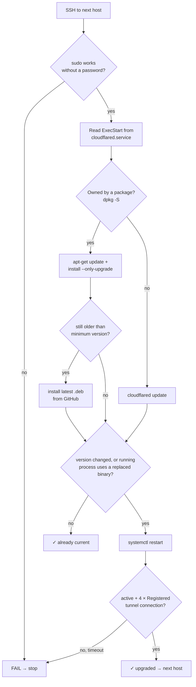

# raspberry-pi_cloudflared_upgrade

Upgrades **cloudflared** (the Cloudflare Tunnel connector) on your Raspberry Pis over SSH, **one Pi at a time**. It stops at the first failure, so the tunnels you haven't touched keep serving traffic.

It does the same steps you'd do by hand, and it **never prints your tunnel token**.



| It handles | How |
|---|---|
| A service that runs a different binary than your `PATH` shows | Reads `ExecStart=` from the unit instead of trusting `which cloudflared` |
| An apt package vs. a standalone binary | `dpkg -S` decides: apt for packages, `cloudflared update` for binaries |
| Your Debian release missing from the Cloudflare repo | Falls back to the latest `.deb` from GitHub |
| The binary was upgraded but the service never restarted | Detects `(deleted)` in `/proc/<pid>/exe` and restarts |
| Errors from the old process shutting down | Only reads log lines from the **new** process ID |
| HTTPS origin certificate problems after upgrading | Fails with a clear message if the new process logs `x509` errors |
| A leftover `/usr/local/bin/cloudflared` that shadows the real one | Reports it; deletes it with `-remove-stale-copies` |

---

## 1. Requirements

| On your machine (Ubuntu) | On each Pi |
|---|---|
| Go 1.22 or newer | `cloudflared` running as a systemd service |
| OpenSSH client (`ssh`) | SSH server, reachable on the LAN |
| An SSH key that can log in to each Pi | `sudo` that works without a password (see 2.3) |

The tool uses only the Go standard library. It runs your system `ssh`, so your `~/.ssh/config`, ssh-agent and `known_hosts` all apply.

---

## 2. One-time setup

### 2.1 Install Go (Ubuntu)

```bash
sudo snap install go --classic      # or: sudo apt install golang-go (check that it is 1.22+)
go version
```

### 2.2 Make sure key-based SSH works for every Pi

The tool runs with `BatchMode=yes`, so it **never** asks for a password or asks you to accept a host key. Each command below must work without prompting:

```bash
ssh-copy-id dudebodacious@192.168.1.2
ssh-copy-id dudebodacious@192.168.1.4
ssh-copy-id dudebodacious@192.168.1.6

# Accept each host key once, and check that no password prompt appears:
for host in 192.168.1.2 192.168.1.4 192.168.1.6; do ssh -o BatchMode=yes dudebodacious@$host hostname; done
```

Optional: add aliases to `~/.ssh/config` so you can pass names instead of IP addresses:

```sshconfig
Host pi1
    HostName 192.168.1.2
    User dudebodacious
Host pi2
    HostName 192.168.1.4
    User dudebodacious
Host pi3
    HostName 192.168.1.6
    User dudebodacious
```

### 2.3 Let sudo run without a password

On each Pi, check:

```bash
sudo -n true && echo "OK: passwordless sudo"
```

Raspberry Pi OS usually sets this up for the first user already. If the check fails, add a drop-in that only allows the commands this tool runs:

```bash
sudo visudo -f /etc/sudoers.d/cloudflared-upgrade
```

```sudoers
dudebodacious ALL=(root) NOPASSWD: /usr/bin/true, \
    /usr/bin/apt-get update -q, \
    /usr/bin/apt-get install -y -q --only-upgrade cloudflared, \
    /usr/bin/dpkg -i *, \
    /usr/bin/systemctl restart cloudflared.service, \
    /usr/bin/journalctl *, \
    /usr/bin/readlink *, \
    /usr/bin/cloudflared update, \
    /usr/local/bin/cloudflared update, \
    /usr/bin/rm -f /usr/local/bin/cloudflared
```

> `dpkg -i *` is effectively root access, since any package can run scripts. It's only needed for the GitHub `.deb` fallback, so remove that line if you prefer and upgrade those hosts by hand.

---

## 3. Build

```bash
git clone git@github.com:mehoggan/raspberry-pi_cloudflared_upgrade.git
cd raspberry-pi_cloudflared_upgrade

make test          # unit tests against a simulated Pi; no hardware needed
make build         # → build/raspberry-pi-cloudflared-upgrade
```

| Target | Output |
|---|---|
| `make build` | `build/raspberry-pi-cloudflared-upgrade` for this machine |
| `make build-all` | `build/…-linux-amd64`, `…-linux-arm64` (to run on a Pi), `…-windows-amd64.exe` |
| `make install` | Copies it to `$(go env GOPATH)/bin/raspberry-pi-cloudflared-upgrade` |
| `make check` | gofmt check + `go vet` + tests |

Or with no Makefile: `go build -o raspberry-pi-cloudflared-upgrade .`

---

## 4. Deploy

Nothing to deploy to the Pis. The tool runs **on your machine** and connects to them. Pick one:

| Option | Command |
|---|---|
| Run from the build folder | `./build/raspberry-pi-cloudflared-upgrade …` |
| Put it on your `PATH` | `make install` (make sure `$(go env GOPATH)/bin` is on `PATH`) |
| Install straight from GitHub | `go install github.com/mehoggan/raspberry-pi_cloudflared_upgrade@latest` (the binary is named `raspberry-pi_cloudflared_upgrade`) |
| Run it *from* a Pi | `make build-all`, then `scp build/raspberry-pi-cloudflared-upgrade-linux-arm64 pi1:~/` (that Pi needs SSH keys for the others) |

---

## 5. Run

### Always start with a dry run

```bash
./build/raspberry-pi-cloudflared-upgrade -user dudebodacious \
  -hosts 192.168.1.4,192.168.1.6,192.168.1.2 -dry-run
```

This connects to each host, reports the binary, version and install method, and changes nothing. It doesn't need sudo.

### Then the real run

```bash
./build/raspberry-pi-cloudflared-upgrade -user dudebodacious \
  -hosts 192.168.1.4,192.168.1.6,192.168.1.2
```

**Put the Pi you depend on most last.** Pi #1 (`192.168.1.2`) carries `ssh.`, `ssh2.` and `pihole.silvahoggan.name`, so upgrade the others first. Connecting by LAN IP means a restart never cuts off the tool's own SSH session.

Example output:

```text
20:52:01  [192.168.1.4] connected (hostname …)
20:52:01  [192.168.1.4] service runs /usr/bin/cloudflared
20:52:01  [192.168.1.4] version on disk: 2026.7.2 (need 2026.10.2 or newer)
20:52:01  [192.168.1.4] installed as: apt package
20:52:02  [192.168.1.4] running apt-get update
20:52:09  [192.168.1.4] running apt-get install --only-upgrade cloudflared
20:52:14  [192.168.1.4] version on disk now: 2026.10.7
20:52:14  [192.168.1.4] restarting cloudflared.service (in-progress requests get up to 30 s to finish)
20:52:20  [192.168.1.4] tunnel healthy: 4 registered connections (process 48211)
...

HOST         HOSTNAME     INSTALLED AS  BEFORE     AFTER      CONNECTIONS  RESULT
192.168.1.4  …            apt package   2026.7.2   2026.10.7  4            upgraded
192.168.1.6  …            apt package   2026.7.2   2026.10.7  4            upgraded
192.168.1.2  raspberrypi  apt package   2026.10.7  2026.10.7  -            already current
```

The exit code is `0` when every host succeeded and `1` if any failed or were skipped, so it's safe to use in scripts and timers.

### Options

| Option | Default | Meaning |
|---|---|---|
| `-hosts` | *(required)* | Comma-separated IP addresses or `~/.ssh/config` aliases, upgraded **in this order** |
| `-user` | from ssh config | SSH user |
| `-port` | from ssh config / 22 | SSH port |
| `-minimum-version` | `2026.10.2` | A host still below this after upgrading counts as failed |
| `-dry-run` | off | Report only; no sudo, no changes |
| `-force-restart` | off | Restart even if nothing changed |
| `-remove-stale-copies` | off | Delete extra `cloudflared` binaries on `PATH` that no package owns |
| `-expected-connections` | `4` | Registered connections needed before a host counts as healthy |
| `-verify-timeout` | `90s` | How long to wait for the tunnel to reconnect |
| `-continue-on-failure` | off | Keep going after a failed host (not recommended) |
| `-service` | `cloudflared.service` | systemd unit name |
| `-connection-timeout` | `15s` | SSH connect timeout |

---

## 6. Keep it up to date automatically (optional)

A weekly **systemd user timer** on your Ubuntu machine:

```bash
mkdir -p ~/.config/systemd/user
```

`~/.config/systemd/user/cloudflared-upgrade.service`

```ini
[Unit]
Description=Upgrade cloudflared on the Raspberry Pis

[Service]
Type=oneshot
ExecStart=%h/go/bin/raspberry-pi-cloudflared-upgrade -user dudebodacious -hosts 192.168.1.4,192.168.1.6,192.168.1.2
```

`~/.config/systemd/user/cloudflared-upgrade.timer`

```ini
[Unit]
Description=Weekly cloudflared upgrade

[Timer]
OnCalendar=Sun 03:17
Persistent=true

[Install]
WantedBy=timers.target
```

```bash
make install
systemctl --user daemon-reload
systemctl --user enable --now cloudflared-upgrade.timer
systemctl --user list-timers cloudflared-upgrade.timer      # next run
journalctl --user -u cloudflared-upgrade.service -n 50      # last run's output
```

> A timer has no access to your desktop ssh-agent. Give it a key it can read: set `IdentityFile ~/.ssh/<key>` for the Pi hosts in `~/.ssh/config`, using a key that has no passphrase and is used only for the Pis.

---

## 7. Troubleshooting

| Message | Fix |
|---|---|
| `ssh to … failed: Permission denied` / `Host key verification failed` | Redo step 2.2 for that host |
| `sudo asks for a password on this host` | Step 2.3 |
| `no cloudflared.service service on this host` | Nothing to upgrade there, or the unit has another name (`-service`) |
| `apt only offered …; installing the latest .deb from GitHub` | Normal on a Debian release the Cloudflare repo doesn't list. To make apt work, set the suite to `any` in `/etc/apt/sources.list.d/cloudflared.list` |
| `after 90s the service is "activating" with 0 of 4 registered connections` | On the Pi: `journalctl -u cloudflared -n 50`. Check internet or DNS, and the Cloudflare status page |
| `the new cloudflared reports certificate errors` | An `https://` origin uses an affected certificate. Replace that certificate. **Don't** turn on `noTLSVerify` |
| `note: … still has another cloudflared at /usr/local/bin/cloudflared` | Rerun with `-remove-stale-copies` |

Run the tests: `make test` (or `go test -v ./...`).

---

## 8. What it doesn't do

| Task | Do it by hand |
|---|---|
| Rotate a tunnel token | Dashboard → Networking → Tunnels → *tunnel* → **Refresh token**, then on that Pi: `sudo cloudflared service uninstall && sudo cloudflared service install "$(cloudflared tunnel token <tunnel-name>)"` (needs a one-time `cloudflared tunnel login`; delete `~/.cloudflared/cert.pem` afterwards) |
| cloudflared in Docker | `docker pull cloudflare/cloudflared:<version>`, then **recreate** the container. A restart keeps the old image |
| Upgrade other packages | Only `cloudflared` is touched (`--only-upgrade cloudflared`) |
